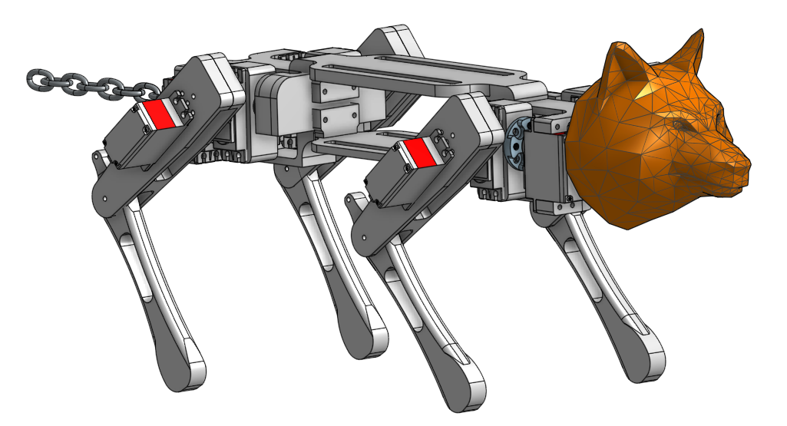

# Quadruped Robot Dog

A Raspberry Pi-powered quadruped robot dog controlled by a PS4 controller. Uses 12 servo motors (3 per leg) and the Adafruit PCA9685 driver for walking, turning, sitting, and dancing. You can find images, videos, and CAD screenshots in the following [google drive folder](https://drive.google.com/drive/folders/1YYMrmW3EgGKGc-ENeqzOh4piAwOo36y2?usp=drive_link).



## Features

- PS4 controller support (USB/Bluetooth)
- Realistic gait & motion logic
- Modular OOP design for leg control
- Powered by Raspberry Pi + PCA9685


## Hardware

- Raspberry Pi (any model with GPIO)
- Adafruit PCA9685 16-Channel PWM Driver
- 12x Servo Motors (e.g. MG90s)
- External 5V power supply
- PS4 Controller (USB or Bluetooth)
- Optional: USB Bluetooth Dongle


## Setup

```bash
sudo apt update && sudo apt upgrade
sudo raspi-config  # Enable I2C
pip3 install -r requirements.txt
sudo apt install i2c-tools
i2cdetect -y 1  # Should show 0x40
```


## Usage

```bash
python3 Controller.py
```


## PS4 Default Controls:

- `R2` - Walk Forward
- `L2` - Walk Backward
- `↑/↓` - Turn Right/Left
- `←/→` - Strafe Left/Right
- `X` - Default Standing Position
- `O` - Sit
- `▢` - Dance
- `△` - Lift a Leg

## File Structure

```
robot-dog/
├── Controller.py      # PS4 input handling, maps buttons to gait functions
├── Walk.py            # Robot/Leg/Motor classes and fixed-angle gait functions
├── WalkIK.py          # Experimental inverse-kinematics gait engine (not used by Controller.py)
├── requirements.txt
├── LICENSE
├── docs/
│   └── CAD.png
└── README.md
```

> **Note:** `WalkIK.py` is a work-in-progress inverse-kinematics rewrite of the gait logic in `Walk.py`. It isn't wired up to `Controller.py` and wasn't fully tuned, but is included for reference.

## License

Released under the [MIT License](LICENSE).